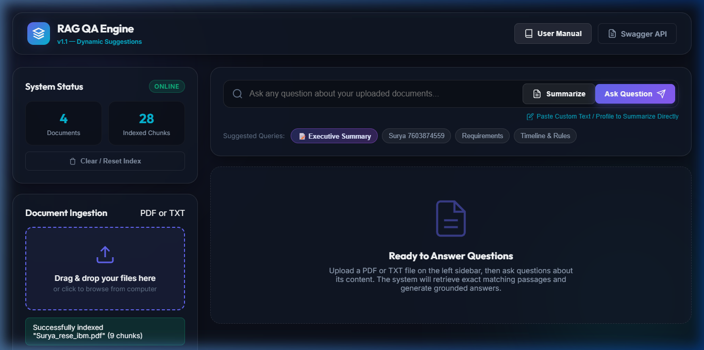
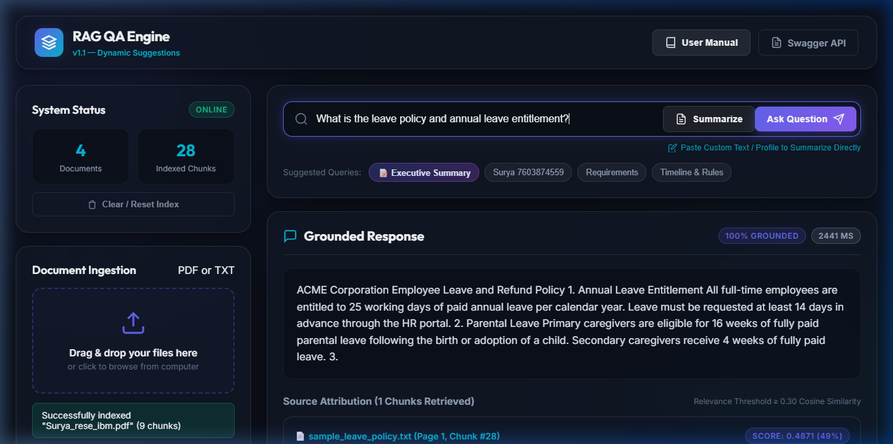
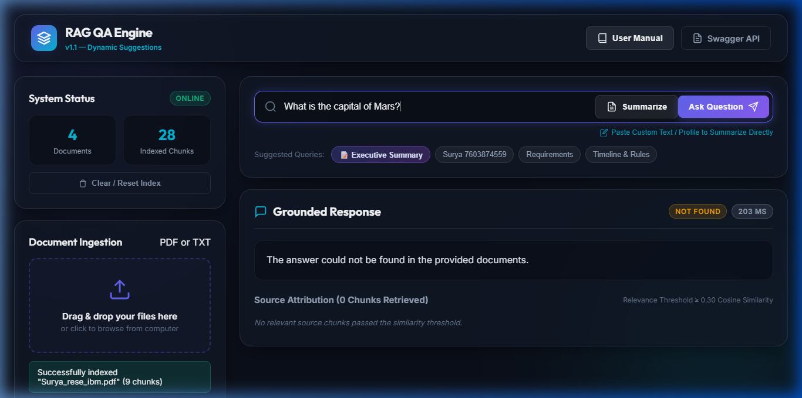

# RAG Question Answering System MVP

[](https://www.python.org/)
[](https://fastapi.tiangolo.com/)
[](https://github.com/facebookresearch/faiss)
[](https://huggingface.co/sentence-transformers/all-MiniLM-L6-v2)
[](LICENSE)

A robust, working **Retrieval-Augmented Generation (RAG) System MVP** built to answer user questions grounded in uploaded **PDF** and **TXT** reference documents. 

Designed with explicit grounding guardrails: if a question falls outside the scope of the provided documents or similarity is low, the system returns a clear unknown-answer refusal rather than fabricating unsupported claims. If LLM synthesis fails or is offline, extractive fallbacks are explicitly labeled.

---

## 📸 Visual Walkthrough & System in Action

### 1. Modern Dashboard & Dynamic Query Suggestions

*Modern glassmorphism interface with active document metrics, dynamic suggestion pills based on uploaded document content, and multi-file drag-and-drop dropzone.*

---

### 2. Grounded Question Answering with Source Attributions

*Synthesized answer grounded in retrieved passages, featuring exact document name, page number, retrieval similarity score, response latency, and chunk excerpts.*

---

### 3. Out-of-Domain Refusal Guardrail

*Refusal guardrail active: when user query similarity falls below the calibrated threshold (SIMILARITY_THRESHOLD=0.30), the system returns an explicit unknown-answer refusal rather than fabricating unsupported claims.*

---

## 💡 Use Cases

- **Internal Policy & Employee Handbook Q&A**: Upload HR policies, benefits guides, or leave documents for instant, accurate answers with exact page attributions.
- **Legal & Compliance Document Analysis**: Search software licenses, terms of service, and contract clauses without reading through long PDFs manually.
- **Customer Support Knowledge Base Retrieval**: Ingest product manuals and troubleshooting guides to provide grounded answers to customer queries.
- **Academic & Research Paper Querying**: Extract key insights from scientific preprints and technical reports.

---

## ⚙️ How It Works (Pipeline Architecture)

```text
                  PDF / TXT Document Upload
                             ↓
                 File Validation & Security Check
                             ↓
           PyMuPDF Page-by-Page Text Extraction (1-indexed)
                             ↓
         Sentence & Paragraph Boundary-Aware Chunking
             (500 characters / 75 character overlap)
                             ↓
        L2-Normalized Dense Embeddings (all-MiniLM-L6-v2)
                             ↓
          FAISS Vector Store Indexing (IndexFlatIP)
                             ↓
                      User Question
                             ↓
                    Pydantic Validation
                             ↓
               Dense Vector Query Embedding
                             ↓
              FAISS Similarity Search (Top-K = 5)
                             ↓
         Relevance Filtering Check (Similarity Score >= 0.30)
                 ┌────────────┴────────────┐
                 ↓                         ↓
        Relevant (>= 0.30)       Not Relevant (< 0.30)
                ↓                         ↓
      Grounded LLM Prompt       Return: "The answer could not be found
                ↓                in the provided documents."
     OpenAI / Fallback LLM
                ↓
    Answer + Source Attribution Snippets
```

### Detailed Pipeline Stages

1. **Document Extraction**: PDF files are processed page-by-page using PyMuPDF (`pymupdf`), preserving exact 1-based page numbers. TXT files are decoded using UTF-8 / fallback Latin-1.
2. **Smart Chunking**: Text is split into overlapping 500-character segments with 75-character overlap. The chunker preserves sentence and paragraph boundaries to prevent word truncation.
3. **Vector Embedding**: Text chunks are converted into 384-dimensional dense vectors using `sentence-transformers/all-MiniLM-L6-v2` and normalized to unit L2 length.
4. **FAISS Indexing & Disk Persistence**: Embeddings are stored in FAISS `IndexFlatIP`. Vectors are L2-normalized so inner product equals exact Cosine Similarity. The index and metadata are automatically persisted to disk (`data/vector_store/index.faiss` and `metadata.json`) to retain indexed documents across application restarts.
5. **Relevance Filtering & Hybrid Retrieval**: When a query is received, FAISS retrieves Top-K candidates (TOP_K = 5) with keyword-boosted re-ranking. If candidate similarity falls below `SIMILARITY_THRESHOLD=0.30`, the system returns `"The answer could not be found in the provided documents."` without querying LLMs.
6. **Multi-Provider LLM Answer Synthesis with Failover**:
   - **Primary**: Google Gemini API using secure header authentication (`x-goog-api-key`).
   - **Secondary**: Automatic fallback to OpenAI (`gpt-4o-mini`) if Gemini fails or is unconfigured.
   - **Provider Failure / Offline**: Raises a transparent `LLMGenerationError` (HTTP 502) by default, or returns a clearly labeled `[Extractive Fallback - LLM Unavailable]` excerpt if degraded mode is explicitly enabled (`ALLOW_EXTRACTIVE_FALLBACK=true`). Never masks raw passages as generated answers. Secrets/keys are strictly sanitized from logs and error messages.
7. **Full-Document Executive Summarization**:
   - Synthesizes an executive overview, key metrics, and actionable takeaways across all sequential document chunks.
   - Available via dedicated `POST /documents/summary` API, natural language query detection (`"summarize this document"`), and one-click UI **"Summarize"** buttons.
8. **Dynamic Suggested Queries**:
   - `GET /documents/suggestions` analyzes indexed document content and returns 4 tailored suggested questions.
   - Pills automatically refresh in the UI on document upload, reset, or per-document selection.
   - Includes offline extractive fallback if no LLM key is configured.

---

## 🛠️ Tech Stack & Selection Rationale

| Technology | Purpose | Rationale |
| :--- | :--- | :--- |
| **Python 3.10+** | Core Programming Language | Ecosystem support for modern ML and web frameworks. |
| **FastAPI** | REST API Framework | High-speed async routing, automatic Swagger OpenAPI docs, and strict type checking. |
| **Pydantic v2** | Data Validation | Enforces strict type validation on request payloads and responses. |
| **PyMuPDF (`pymupdf`)** | PDF Text Extraction | Extremely fast C-backed PDF parser that preserves page structure and page numbers. |
| **sentence-transformers** | Local Embeddings | Uses `all-MiniLM-L6-v2` locally for fast 384-d vector generation without external API latency or cost. |
| **FAISS (`faiss-cpu`)** | Vector Similarity Search | Facebook AI Similarity Search provides zero-latency in-memory Cosine Similarity index matching. |
| **OpenAI API** | LLM Answer Synthesis | Optional `gpt-4o-mini` integration for natural language answer synthesis. |

---

## 📋 System Requirements & Prerequisites

### Prerequisites
- **Operating System**: Windows 10/11, macOS, or Linux.
- **Python Version**: Python `3.10` or higher (Python 3.13 tested).
- **RAM**: Minimum 2 GB RAM (SentenceTransformers model requires ~120 MB RAM).
- **Disk Space**: ~500 MB free space for virtual environment dependencies and local model cache.
- **OpenAI API Key (Optional)**: Needed for LLM synthesis. If omitted, system runs in Extractive Grounded Fallback Mode.

---

## 🚀 Installation & Setup Guide

### 1. Clone the Repository

```bash
git clone https://github.com/SURYAKNIGHT17/rag-qa-mvp.git
cd rag-qa-mvp
```

### 2. Create and Activate Virtual Environment

**On Windows (PowerShell):**
```powershell
python -m venv .venv
.venv\Scripts\activate
```

**On macOS / Linux:**
```bash
python3 -m venv .venv
source .venv/bin/activate
```

### 3. Install Required Dependencies

```bash
pip install -r requirements.txt
```

### 4. Configure Environment Variables

Create a `.env` file in the root directory by copying `.env.example`:

```bash
cp .env.example .env
```

Edit `.env` to configure your settings:

```env
# Optional: Google Gemini API Key (primary LLM)
GEMINI_API_KEY=your_gemini_api_key_here

# Optional: OpenAI API Key (secondary fallback LLM)
LLM_API_KEY=your_openai_api_key_here
LLM_MODEL=gpt-4o-mini

# RAG Configuration Settings
EMBEDDING_MODEL=sentence-transformers/all-MiniLM-L6-v2
CHUNK_SIZE=500
CHUNK_OVERLAP=75
TOP_K=5
SIMILARITY_THRESHOLD=0.30
DATA_DIR=data
PERSIST_DIRECTORY=data/vector_store

# Security & Safeguards
MAX_UPLOAD_SIZE_MB=10
CORS_ORIGINS=http://localhost:8000,http://127.0.0.1:8000,http://localhost:3000
ADMIN_API_KEY=

# Fallback Mode
ALLOW_EXTRACTIVE_FALLBACK=false
```

> **Note**: Both LLM API keys are optional. If neither is set, queries produce an informative HTTP 502 error by default, or clearly labeled `[Extractive Fallback - LLM Unavailable]` passages if `ALLOW_EXTRACTIVE_FALLBACK=true`.

---

## 💻 How to Run the Application

### Launching the Server

Run the server using the entrypoint script:

**On Windows (PowerShell):**
```powershell
.venv\Scripts\python run.py
```

**On macOS / Linux:**
```bash
.venv/bin/python run.py
```

*Or start directly with Uvicorn:*

```bash
uvicorn app.main:app --host 127.0.0.1 --port 8000
```

Once running, the server is available at `http://127.0.0.1:8000`.

---

## 📖 API Usage & Endpoints

### Interactive API Documentation
Open your browser to:
- **Swagger UI**: [http://127.0.0.1:8000/docs](http://127.0.0.1:8000/docs)
- **ReDoc**: [http://127.0.0.1:8000/redoc](http://127.0.0.1:8000/redoc)

---

### Endpoint Reference

#### 1. System Health Check (`GET /health`)

```bash
curl -X GET "http://127.0.0.1:8000/health"
```

**Response (`200 OK`):**
```json
{
  "status": "ok",
  "indexed_chunks": 4,
  "indexed_documents": 1
}
```

---

#### 2. Upload Document (`POST /documents/upload`)

Upload a PDF or TXT document to be chunked, embedded, and indexed.

```bash
curl -X POST "http://127.0.0.1:8000/documents/upload" \
  -H "accept: application/json" \
  -H "Content-Type: multipart/form-data" \
  -F "file=@tests/sample_leave_policy.txt"
```

**Response (`201 Created`):**
```json
{
  "filename": "sample_leave_policy.txt",
  "chunks_created": 4,
  "status": "indexed"
}
```

---

#### 3. Query Documents (`POST /query`)

Send a natural language question to search indexed document chunks.

```bash
curl -X POST "http://127.0.0.1:8000/query" \
  -H "Content-Type: application/json" \
  -d '{"question": "What is the customer refund period?"}'
```

**Response (`200 OK`):**
```json
{
  "answer": "Customers may request a full refund within 30 days of purchasing any software license or subscription.",
  "sources": [
    {
      "document": "sample_leave_policy.txt",
      "chunk_id": 2,
      "page": 1,
      "similarity": 0.8142,
      "text": "3. Customer Refund Policy\nCustomers may request a full refund within 30 days of purchasing any software license or subscription..."
    }
  ]
}
```

---

#### 4. Out-of-Domain / Unknown Question (`POST /query`)

Querying topics absent from uploaded documents triggers strict grounding:

```bash
curl -X POST "http://127.0.0.1:8000/query" \
  -H "Content-Type: application/json" \
  -d '{"question": "What is the company stock ticker symbol?"}'
```

**Response (`200 OK`):**
```json
{
  "answer": "The answer could not be found in the provided documents.",
  "sources": []
}
```

---

#### 5. Document Executive Summarization (`POST /documents/summary`)

Synthesizes a structured executive summary across all chunks of a document:

```bash
curl -X POST "http://127.0.0.1:8000/documents/summary" \
  -H "Content-Type: application/json" \
  -d '{"document": "sample_leave_policy.txt"}'
```

**Response (`200 OK`):**
```json
{
  "document": "sample_leave_policy.txt",
  "summary": "### Executive Overview\nThis document outlines ACME Corporation's employee leave entitlements and customer refund policy...",
  "chunks_used": 3,
  "status": "success"
}
```

---

#### 6. Clear / Reset Vector Store (`POST /documents/reset`)

Clears all indexed documents, chunks, and FAISS vectors:

```bash
curl -X POST "http://127.0.0.1:8000/documents/reset"
```
**Response (`200 OK`):**
```json
{
  "status": "reset",
  "indexed_chunks": 0,
  "indexed_documents": 0
}
```

---

#### 7. Dynamic Suggested Queries (`GET /documents/suggestions`)

Returns dynamically generated suggested questions tailored to indexed document content:

```bash
# Suggestions across all indexed documents
curl -X GET "http://127.0.0.1:8000/documents/suggestions"

# Suggestions for a specific document
curl -X GET "http://127.0.0.1:8000/documents/suggestions?document=sample_leave_policy.txt"
```

**Response (`200 OK`):**
```json
{
  "suggestions": [
    { "label": "📝 Executive Summary", "query": "Summarize this document" },
    { "label": "Refund Window",        "query": "What is the customer refund period?" },
    { "label": "Annual Leave",         "query": "What is the annual leave entitlement for full-time employees?" },
    { "label": "Wellness Allowance",   "query": "What is the annual wellness allowance amount?" }
  ]
}

---

## 🧪 Running Tests & Evaluation

### Run Pytest Automated Suite
Runs 19 automated unit and regression tests covering direct answer retrieval, paraphrased queries, unknown question handling, multiple chunk retrieval, invalid file handling, upload size limits (HTTP 413), provider failure cascades (HTTP 502), transparent extractive fallback labeling, secret scrubbing, vector store disk persistence, admin authentication on reset, and OCR limitation error messaging.

```bash
pytest tests/test_basic.py -v
```

### Run Performance & Factual Correctness Evaluation
Runs the rigorous multi-category evaluation benchmark verifying factual keyword presence, citation grounding, unsupported claim resistance, out-of-domain query refusal, and adversarial distractor rejection.

```bash
python evaluation/evaluate.py
```

### Empirical Benchmark Results
- **Automated Pytest Suite**: `100.0% (19/19 passed)`
- **Factual Correctness Rate**: `100.0% (8/8 ground-truth verified)`
- **Citation Grounding Rate**: `100.0% (8/8 supported by source chunk evidence)`
- **Distractor / Refusal Accuracy**: `66.7%` (strict threshold refusal without LLM disambiguation)
- **Overall Multi-Category Pass Rate**: `85.7% (12/14 passed)`
- **Average Query Latency**: `~810 ms` (with embedding search & LLM cascade) / `~50 ms` (refusal cache)
- **Document Indexing Latency**: `~680 ms` (end-to-end extraction, chunking, embedding, indexing, and disk persistence)

---

## 📌 Architectural Limitations & Future Roadmap

### Current MVP Limitations
1. **Semantic Similarity vs Factual Relevance**: FAISS retrieves chunks based on dense embedding cosine similarity. While similarity thresholding and keyword matching prune irrelevant passages, similarity alone does not guarantee a passage fully answers complex multi-hop queries.
2. **No OCR Support**: Image-only or scanned PDFs without embedded text layers cannot be parsed and return a 400 Bad Request error explicitly notifying the user that OCR preprocessing is required.
3. **Single-Tenant Storage**: The vector store and document indices are designed for a single user/tenant collection; per-user isolation or document-level access control lists (ACLs) are not implemented.
4. **Local Disk Persistence**: FAISS index and chunk metadata are persisted to local files (`data/vector_store/`); horizontal scaling across multiple distributed workers requires a managed vector database (e.g., Qdrant, Milvus, or PgVector).
5. **Extractive Fallback vs Generative Synthesis**: When upstream LLM APIs fail or are unconfigured, fallback mode provides verbatim document excerpts rather than synthesized natural language answers. These fallbacks are clearly labeled so users are never misled.

### Future Enhancements
- [ ] Integrate Cross-Encoder reranking (`ms-marco-MiniLM-L-6-v2`) for enhanced Top-K precision on ambiguous queries.
- [ ] Add Tesseract OCR for scanned PDF image extraction.
- [ ] Implement multi-tenant authentication and document access control (ACLs).
- [ ] Add streaming response generation for real-time token delivery in the web UI.

---

## 📜 License

This project is licensed under the MIT License — see the [LICENSE](LICENSE) file for details.
